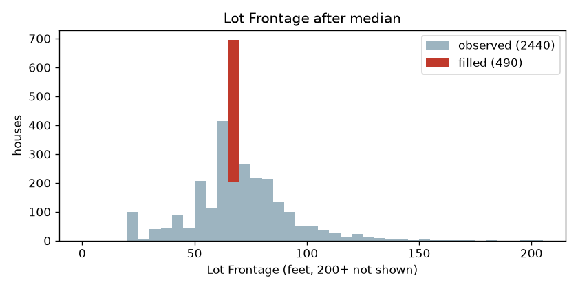
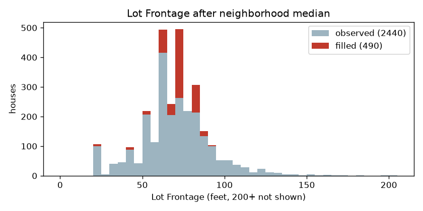

# HW5 report: Ames Housing quality audit

Every number below is produced by `make all`; the full tables are in `reports/results/`.

## 1 Provenance

`AmesHousing.txt` was downloaded on 2026-11-23 from https://jse.amstat.org/v19n3/decock/AmesHousing.txt
(De Cock, 2011). On arrival it has **2,930 rows and 82 columns**, tab-separated, as the brief expects.
Source, citation and terms are in the README. `src/download.py` never overwrites the raw copy, and
every fix below writes a new file in `data/processed/`.

## 2 Validation: failures on the raw file

`src/validate.py` checks the schema (exact 82 columns: 39 numeric, 43 text), 17 range rules, 13
allowed-value rules from the dictionary, and 4 cross-column rules. Each rule names its source in a comment.
`make validate` passes: validation **fails on the raw file and passes on the cleaned file**.

| Rule that failed on the raw file | Rows | What we did |
| --- | ---: | --- |
| Range: Garage Yr Blt in [1864, 2010] (study period) | 1 (Order 2261: 2207) | Typo. House built 2006, remodelled 2007, sold 2007 → set to **2007** |
| Allowed: MS Zoning `C (all)`, `I (all)`, `A (agr)` | 25 + 2 + 2 | Recoded to the dictionary codes `C`, `I`, `A` |
| Allowed: Neighborhood `NAmes` | 443 | Recoded to `Names`, the dictionary's code for North Ames |
| Allowed: Bldg Type `Duplex`, `2fmCon`, `Twnhs` | 109 + 62 + 101 | Recoded to `Duplx`, `2FmCon`, `TwnhsI` (end units already use `TwnhsE`, so `Twnhs` = inside unit; an assumption) |
| Allowed: Exterior 2nd `CmentBd`, `Wd Shng`, `Brk Cmn` | 126 + 81 + 22 | Recoded to `CemntBd`, `WdShing`, `BrkComm` |
| Allowed: Sale Type `"WD "` (trailing space) | 2,536 | Stripped to `WD` |
| Cross: Year Remod/Add ≥ Year Built | 1 (Order 851) | Remodel set to the build year (dictionary: "same as construction date if no remodeling") |
| Cross: Year Remod/Add ≤ Yr Sold (+1 for a `Partial` sale) | 1 (Order 2181) | Remodel 2 years after the sale, so none at sale time → set to the build year |
| Cross: Garage Yr Blt ≤ Yr Sold (+1 for `Partial`) | 1 (Order 2261) | Same row as the range failure, fixed there |
| Cross: a house with a garage has no "No Garage" quality/condition | 1 (Order 1357) | Garage Qual and Cond set to unknown (`NaN`), not "none" |
| Cross: Mas Vnr Type and Mas Vnr Area agree | 10 | e.g. `None` with 344 sq ft. We cannot tell which is wrong, so both set to `NaN` |

The code mismatches are reported, then mapped by an explicit, logged table (`RECODE` in `src/clean.py`,
log in `reports/results/changes.md`); nothing is mapped silently. One rule needed care: three new houses
were sold before they were finished (`Sale Condition = Partial`, which the dictionary defines as "not
completed when last assessed"). So the rule "built no later than sold" allows one year for partial sales
instead of flagging real presales.

## 3 Sentinels and structural absence

Loading with the pandas default turns three different strings into `NaN`:

| String | Where | What the dictionary says | Our decision |
| --- | --- | --- | --- |
| `"NA"` | 14 columns: Alley 2,732, Pool QC 2,917, Misc Feature 2,824, Fence 2,358, Fireplace Qu 1,422, 4 garage columns 157–158, 5 basement columns 79 | **"none"** in every one: No alley access, No Basement, No Fireplace, No Garage, No Pool, No Fence, None | Kept as the category `"NA"` (structural absence, not unknown) |
| `"None"` | Mas Vnr Type, 1,752 | "None" = no masonry veneer, a real category | Kept as a category |
| `""` (empty cell) | Lot Frontage 490, Garage Yr Blt 159, Mas Vnr 23, a few basement / garage / Electrical cells | Not a dictionary code | **True missing** → `NaN` |

So the second load uses `keep_default_na=False, na_values=[""]`: only an empty cell means unknown.
With the default load, 2,917 houses would look like they have an unknown pool quality, and an imputer
would invent pool qualities for houses with no pool. Two `"NA"` values were wrong: Order 1357 has a
360 sq ft detached garage but "No Garage" quality, so those are unknown, not none. Garage Yr Blt is empty
for the 157 houses with no garage (structural, explained by `Garage Type = "NA"`) and for 2 houses
with a garage (truly unknown).

**Zeros.** The numeric columns where 0 means "none" are true zeros, not sentinels: 0 sq ft of garage
*is* the garage area of a house with no garage, and the counts agree with the categories (Garage Area 0
in 157 rows, all with Garage Type "NA"; Total Bsmt SF 0 ↔ 79 "No Basement"; Pool Area 0 ↔ 2,917 "No
Pool"; Fireplaces 0 ↔ 1,422 "No Fireplace"). Averaging them is meaningful (average garage space per
house), so they stay 0. Unknown values in this file are written as empty cells, never as 0. Two small
exceptions: Mas Vnr Area 0 with a real veneer type (3 rows, handled in Part 2), and Misc Val 0 for 3
houses that do have a misc feature, where 0 may hide an unknown value; we left those as they are.

## 4 Keys and duplicates

| Check | Result |
| --- | --- |
| `Order` unique (row number of the file, identifies one record) | yes, 2,930 values |
| `PID` unique (parcel ID, identifies one property) | yes, 2,930 values |
| Exact duplicate rows / duplicates ignoring `Order` | 0 / 0 |
| Duplicate `Order` / duplicate `PID` | 0 / 0 |
| Neighborhood lookup (28 rows, full names from the dictionary), `validate="many_to_one"` | 2,930 rows before, 2,930 after, 0 without a name |

**Key choice: `PID`.** It names the property, so it would still work if the file were re-sorted or
appended, while `Order` is only a position. Because every PID appears once, no house was sold twice in
this file, so PID also identifies one sale. With repeat sales the key would be (PID, Yr Sold, Mo Sold).
The lookup join only worked after recoding `NAmes` to the dictionary's `Names`; before that, 443 sales
had no full name, which is how a code mismatch silently loses rows in a join.

## 5 Missingness mechanism

| Column | Missing | Share |
| --- | ---: | ---: |
| Lot Frontage | 490 | 16.7% |
| Mas Vnr Area | 33 | 1.1% (23 empty cells + 10 we set to unknown in Part 2) |

**Lot Frontage.** Houses without a value differ from houses with one (notebook §4.1 comparison):

| Observed column | With a value | Missing | p-value |
| --- | ---: | ---: | ---: |
| Lot Area (sq ft, mean) | 9,710 | 12,331 | 1e-05 |
| Gr Liv Area (mean) | 1,489 | 1,553 | 0.01 |
| Year Built (mean) | 1970.5 | 1975.5 | 3e-05 |
| SalePrice (mean) | 180,100 | 184,263 | 0.19 |
| Lot Config: share missing | Inside 12.8%, Corner 20.4%, FR2 23.5%, **CulDSac 48.9%** | | χ² p = 6e-35 |
| Lot Shape: share missing | **Regular 7.1%**, IR1 33.2%, IR2 36.8% | | χ² p = 4e-73 |
| Neighborhood: share missing | 0% (Bluestem, Briardale) to 55% (Clear Creek); 100% in Green Hills and Landmark (3 houses) | | χ² p = 1e-40 |

**MCAR is rejected**: under MCAR every group would have about the same share missing, and here a cul-de-sac
lot is almost four times as likely to be missing as an inside lot. The pattern follows lot **geometry**:
irregular lots, cul-de-sacs and big lots, where "feet of street" is hard to measure. Those columns are
observed, so **MAR given lot shape, lot configuration and neighborhood** is our working claim.
What the data cannot tell us: whether, *within* the same shape and configuration, the missing lots have
unusually short or long frontage (MNAR); MAR and MNAR cannot be told apart from the data alone.

**If Lot Frontage were MNAR**, a plausible process: the assessor leaves the field blank when the frontage is
tiny or ill-defined, such as a flag lot reached by a narrow driveway or a pie-shaped lot on a cul-de-sac
bulb. Then the value itself (very short frontage) causes the blank, and every fill would overstate it.

**Mas Vnr Area.** Missing houses are much newer (mean Year Built 1998 vs 1971, p = 7e-11) and more
expensive ($225k vs $180k, p = 0.003); Lot Area (p = 0.55), Lot Config (χ² p = 0.95) and Lot Shape (p = 0.86)
show no difference. 5.7% of `Partial` (unfinished new-house) sales are missing against 0.7% of normal sales,
and the 23 original blanks have a median build year of 2006. **MCAR is rejected; MAR on Year Built / Sale
Condition** fits: the veneer was not yet recorded for houses still being finished. The data cannot tell us
whether those houses got a veneer at all.

## 6 Imputation strategy and defense

| Strategy | Distinct fill values | std before | std after | corr with Lot Area before | after |
| --- | ---: | ---: | ---: | ---: | ---: |
| Overall median (`SimpleImputer`) | 1 | 23.37 | 21.33 | 0.491 | 0.363 |
| Median by Neighborhood (`GroupMedianImputer`) | 20 | 23.37 | 21.72 | 0.491 | 0.389 |

Both fills shrink the spread and the correlation with Lot Area, because the missing houses have *big*
lots but receive typical frontages. Two neighborhoods (Green Hills, Landmark; 3 houses) have no observed
Lot Frontage at all and fall back to the overall median.

**Choice: median by Neighborhood** (*draft, to be rewritten by the author*). Part 5 found Lot Frontage
is not MCAR: whether it is missing depends on observed features of the lot and its neighborhood. Under MAR,
the columns that predict missingness belong in the fill (notebook §4.3). A single overall median ignores
that and puts all 490 houses on one spike. Lots in one neighborhood were laid out together with similar
widths, so the neighborhood median uses location, which we observe, and loses less of the spread and of the
link to Lot Area. It is also easy to fit inside a pipeline. Its limit: it does not use Lot Config, so the
over-represented cul-de-sac lots (median frontage 50 ft vs 66 ft inside) get a frontage that is too wide.
If the data were MNAR, no observed column would remove that bias.

## 7 Leakage-safe evaluation

`LinearRegression` on 13 numeric features (README), target log(SalePrice), 5-fold `KFold(random_state=5110)`.

| Variant | Fill | Mirrors | CV RMSE (log price) | vs C |
| --- | --- | --- | ---: | ---: |
| A | median Lot Frontage per SalePrice quintile, full table | 6.1 | 0.1619257 | −0.0000005 |
| B | neighborhood median, fitted on full table before CV | 6.2 | 0.1619168 | −0.0000093 |
| C | neighborhood median inside a `Pipeline` | 6.3 | 0.1619261 | 0 |

- **Correct values: C.** The imputer is refitted on each training fold, so a test house's fill comes only
  from training houses. **A leaks the target**: each missing frontage is filled from the house's own price
  group, so the fill carries price information into the features, test folds included. **B leaks test rows**:
  the neighborhood medians were computed with the test-fold houses, so they helped make their own fill.
- **A could not price an unsold house**: to fill its frontage you must know which price quintile it falls
  in, and that needs the sale price we are trying to predict.
- **B vs C is 0.0000093 in RMSE (under 0.01%)**. It is that small because a median is robust: removing 20%
  of 2,440 observed values moves a neighborhood median by 0.2–0.6 ft on average (at most 4 ft; see
  `p7_median_drift.md`), and Lot Frontage adds little once Gr Liv Area and Overall Qual are in the model.
  The leak is real but small here. It would grow with a KNN or iterative imputer, smaller data, or a fill
  that sees the target.
- A is also almost equal to C in the full model for the same reason. With Lot Frontage as the only feature,
  A's target leak shows: RMSE 0.3796 (A) vs 0.3827 (C), even though C also gets to use neighborhood.

## 8 What we changed, and what this data cannot tell us

**Changed** (all logged in `changes.md`, raw file untouched): decoded only empty cells to `NaN` and kept
"NA"/"None" as categories; recoded 5 sets of category codes to the dictionary; fixed one impossible
garage year and two impossible remodel years; set 2 garage fields and 10 masonry pairs to unknown where
the values contradicted each other. No rows were dropped and no duplicates existed.

**Cannot tell us:**
- Whether the missing Lot Frontage values are MAR or MNAR: the data can reject MCAR, but it cannot
  confirm MAR.
- Which value was right in the 10 contradictory masonry rows, or whether our reading of `Twnhs` as an
  inside unit is right; the dictionary does not say.
- Anything about houses that did not sell: this is the population of 2006–2010 sales, not of all Ames
  homes, and the sale years include the 2008 housing crash.
- Whether a "none" in the record is up to date: the assessor's data describes the house when last
  assessed, which can differ from the house at the time of sale (the `Partial` sales show this).
